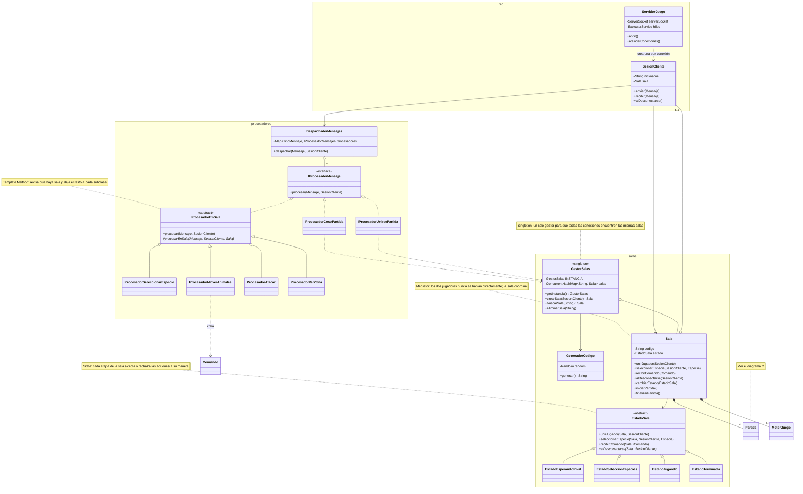
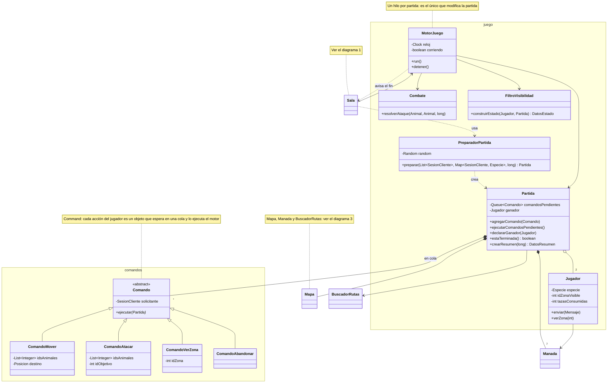
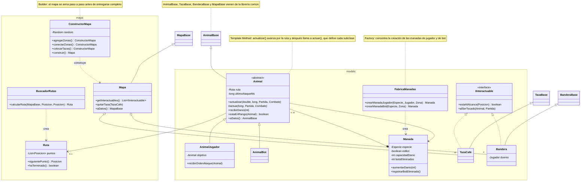

# Jungle Attack — Servidor

Caso #2 de Programación Orientada a Objetos, Tecnológico de Costa Rica.

**Autores:** Ignacio Hernández Camacho y Julian Moya

Este es el servidor de *Jungle Attack*, un juego de batalla para dos jugadores ambientado en un bosque de Costa Rica. La explicación del juego, cómo se juega y la arquitectura completa de los tres proyectos están en el [README del cliente](https://github.com/IgnacioHdzz/caso2-cliente-POO). Las clases que comparten el servidor y el cliente están en la [librería común](https://github.com/IgnacioHdzz/caso2-comun-POO).

## Qué hace el servidor

El servidor es la autoridad del juego. Recibe por sockets las intenciones de los jugadores ("quiero mover estos animales", "quiero atacar a ese"), decide si se pueden cumplir, aplica todas las reglas y le envía a cada jugador lo que pasó. Los clientes no deciden nada, solo muestran lo que el servidor les dice.

También es quien protege la niebla de guerra. Cada jugador solo puede ver las zonas donde tiene animales, y el servidor le envía únicamente lo que hay en la zona que está mirando. Como lo demás nunca sale del servidor, no hay forma de que un cliente vea lo que no le corresponde, aunque alguien lo modifique.

Puede atender **varias partidas al mismo tiempo**. Cada una se identifica con un código de cuatro caracteres que el creador comparte con su rival.

## Cómo correrlo

Primero hay que instalar la librería común. En la carpeta de `caso2-comun-POO`:

```
mvn install
```

Después, en la carpeta de este proyecto:

```
mvn compile exec:java
```

El servidor queda escuchando en el puerto 5000 hasta que se cierre la consola. Si el puerto ya está ocupado, avisa con un mensaje y termina.

Para probarlo sin la interfaz gráfica, hay un cliente de consola en las pruebas. Se abre en otra consola con:

```
mvn test-compile exec:java "-Dexec.mainClass=servidor.ClienteConsola" "-Dexec.classpathScope=test"
```

## Organización

El código está dividido en capas, de la red hacia las reglas del juego:

- **`servidor.red`**: acepta conexiones y representa a cada cliente conectado.
- **`servidor.procesadores`**: interpreta cada tipo de mensaje que llega.
- **`servidor.salas`**: las partidas como salas, desde que alguien la crea hasta que termina.
- **`servidor.juego`** y **`servidor.juego.comandos`**: la partida en curso, su ciclo de juego y las acciones de los jugadores.
- **`servidor.modelo`**: los animales, las manadas, las tazas y las banderas.
- **`servidor.mapa`**: las zonas, los caminos y el cálculo de rutas.

## Diagramas de clases

El diagrama está dividido en tres partes. Las clases que aparecen en una parte y pertenecen a otra se marcan con una nota.

### 1. Red, procesadores y salas

Cómo llega un mensaje y cómo se maneja una sala.



### 2. Juego y comandos

La partida en curso y su ciclo.



### 3. Modelo y mapa

Lo que hay en el mapa y cómo se recorre.



## Cómo funciona

### Desde que un jugador se conecta hasta que juega

`ServidorJuego` espera conexiones. Cada vez que un cliente se conecta, crea una `SesionCliente` que lo representa, con dos hilos propios: uno que lee sus mensajes y otro que le escribe.

Cada mensaje que llega pasa por `DespachadorMensajes`, que busca en un mapa el procesador de ese tipo y se lo entrega. Crear una partida y unirse a una se resuelven con `GestorSalas`, el único objeto que conoce todas las salas. Las demás acciones necesitan que el jugador ya esté en una sala, y se le pasan a esa sala.

La `Sala` atraviesa cuatro etapas: esperando al rival, elección de especies, juego y terminada. Cuando los dos jugadores eligieron su especie, la sala prepara la partida, avisa a cada uno que el juego empieza y arranca el motor.

### El ciclo de juego

Cada partida tiene su propio `MotorJuego`, que corre en un hilo aparte y se repite unas veinte veces por segundo. En cada vuelta:

1. Ejecuta las acciones que los jugadores enviaron desde la vuelta anterior.
2. Actualiza a cada animal vivo: avanza por su ruta y después actúa. Los bots atacan solos a los animales de los jugadores que tengan cerca, y los animales de un jugador atacan solo al objetivo que su dueño les indicó.
3. Revisa si algún animal tocó una taza de café o una bandera.
4. Le envía a cada jugador lo que puede ver.

Cuando alguien gana, el motor le pide a la sala que termine la partida, y la sala envía el resultado a los dos jugadores.

### Las reglas

Cada jugador maneja una manada de diez animales. En el mapa también hay cinco manadas de bots de cuatro animales, una por cada especie que nadie eligió. Cuando dos animales enemigos están cerca, pueden atacarse, con un tiempo de espera de un segundo entre ataque y ataque. El daño de un ataque es la capacidad de daño de su manada.

Las tazas de café aumentan en uno la capacidad de daño de toda la manada que la toca, y desaparecen. Por cada dos bots que elimina una manada, sus animales vivos recuperan un punto de energía, sin pasar del máximo.

Gana quien lleve un animal a la bandera del rival. También se gana si el rival abandona la partida.

## Patrones de diseño

**Singleton** (`GestorSalas`). El Singleton garantiza que una clase tenga un único objeto, accesible desde cualquier lugar. Aquí hace falta porque todas las conexiones deben encontrar las mismas salas: si cada una tuviera su propio gestor, nadie podría unirse a la partida de otro. El objeto se crea al cargar la clase, así que no hay riesgo de que dos hilos creen dos gestores a la vez.

**State** (`Sala`, `EstadoSala` y sus cuatro subclases). El patrón State hace que un objeto cambie su comportamiento según la etapa en que está, delegándolo en un objeto que representa esa etapa. Sin él, cada método de la sala tendría una cadena de `if` preguntando en qué etapa está. Con él, cada etapa es una clase que solo implementa lo que acepta. `EstadoSala` rechaza todo por defecto, así que, por ejemplo, unirse a una partida que ya empezó responde un error sin que nadie tenga que escribir ese caso.

**Mediator** (`Sala`). El Mediator centraliza la comunicación entre varios objetos para que no dependan unos de otros. Los dos jugadores nunca se hablan directamente: todo pasa por la sala, que decide qué se le envía a cada uno.

**Command** (`Comando` y sus subclases). El patrón Command convierte una acción en un objeto, para poder guardarla y ejecutarla después. Las acciones llegan por los hilos de lectura de cada jugador, pero la partida solo la modifica el hilo del motor. Por eso los procesadores no tocan la partida: crean un comando y lo dejan en una cola, y el motor los ejecuta al inicio de su siguiente vuelta.

**Template Method** (`Animal` y `ProcesadorEnSala`). El Template Method escribe una vez los pasos comunes de un algoritmo y deja que las subclases completen la parte que cambia. En `Animal`, el método `actualizar` siempre avanza por la ruta y después llama a `actuar`, que cada subclase define distinto: el bot busca enemigos y el animal del jugador ataca a su objetivo. En `ProcesadorEnSala`, el método `procesar` revisa que el jugador esté en una sala y después llama a `procesarEnSala`, que cada procesador define.

**Factory** (`FabricaManadas`). Una fábrica concentra la creación de objetos complejos en un solo lugar. Crear una manada implica crear sus animales con su energía inicial, ubicarlos en su zona y asignarles identificadores únicos, y eso queda en una sola clase.

**Builder** (`ConstructorMapa`). El Builder arma un objeto en varios pasos antes de entregarlo terminado. El mapa se construye agregando las zonas, conectándolas con caminos y colocando las tazas, y solo al final se entrega con `construir()`.

## Decisiones de diseño

**Solo el motor modifica la partida.** Cada jugador tiene su propio hilo de lectura y la partida tiene su hilo de motor. Si los hilos de lectura cambiaran la partida directamente, podrían hacerlo justo mientras el motor la está recorriendo. En lugar de proteger cada parte de la partida con candados, decidimos que solo un hilo la toque y que los demás le dejen sus pedidos en una cola. La cola es segura para varios hilos, así que es lo único que necesita protección.

**Cada sala se protege a sí misma.** Los métodos públicos de `Sala` son `synchronized`, así que dos jugadores no pueden, por ejemplo, unirse a la misma sala en el mismo instante. Como el candado es de cada sala, las demás partidas no se detienen mientras tanto.

**Los códigos se reservan de forma atómica.** El gestor guarda las salas en un `ConcurrentHashMap`, y reserva cada código con `putIfAbsent`, que revisa y guarda en un solo paso. Así, dos salas creadas al mismo tiempo no pueden quedarse con el mismo código.

**Un solo algoritmo de rutas.** Las rutas se calculan con Dijkstra sobre el grafo de zonas, donde las zonas son los nodos y los caminos, las aristas. Como los caminos tienen longitudes distintas, Dijkstra encuentra el recorrido más corto en distancia, y no solo el que pasa por menos zonas, que es lo que daría una búsqueda en anchura. Por eso no hacía falta tener dos algoritmos.

**Se envía solo la parte base de cada elemento.** Cada animal, taza y bandera tiene un método `aDatos()` que devuelve una copia con solo los datos de la librería común. Así el cliente recibe lo que necesita para dibujar, y nada de la lógica interna del servidor.

**El reloj y el azar se reciben desde afuera.** `MotorJuego` recibe un `Clock`, y `GeneradorCodigo`, `ConstructorMapa` y `PreparadorPartida` reciben un `Random`. En el programa real son el reloj del sistema y un azar normal, pero en las pruebas se pueden reemplazar por un reloj controlado o un azar con semilla fija, para obtener siempre el mismo resultado.

## Pruebas

Las pruebas están en `src/test/java` y se corren con:

```
mvn test
```

Revisan el daño, la curación y el tiempo de espera entre ataques de los animales, las tazas y el bono de energía de las manadas, el cálculo de rutas con Dijkstra (incluidos casos límite), el avance por una ruta y el formato de los códigos de sala. También hay una prueba de integración que construye el mapa y crea las manadas de bots.
