# Jungle Attack — Servidor

Caso #2 POO

**Autores:** Ignacio Hernández Camacho y Julian Moya

Servidor de *Jungle Attack*, un juego de batalla jugador contra jugador ambientado en un bosque de Costa Rica. La arquitectura es cliente-servidor: el servidor recibe las intenciones de los jugadores por sockets (mensajes JSON), aplica todas las reglas del juego y le envía a cada cliente solo lo que tiene permitido ver. Soporta N partidas al mismo tiempo.

El cliente está en el repositorio [`caso2-cliente-POO`](https://github.com/IgnacioHdzz/caso2-cliente-POO).

> **Estado:** especificación de diseño (spec). Puede ajustarse durante la implementación.

## Diagrama de clases

```mermaid
classDiagram
    direction TB

    namespace principal {
        class MainServidor {
            +main(String[] args)$
        }
    }

    namespace constantes {
        class Constantes {
            <<final>>
            +int PUERTO$
            +int RADIO_ENCUENTRO$
            +double VELOCIDAD_ANIMAL$
            +long ENFRIAMIENTO_ATAQUE_MS$
            +int ENERGIA_MAX_JUGADOR$
        }
    }

    namespace red {
        class ServidorJuego {
            -ServerSocket serverSocket
            +iniciar()
        }
        class ConexionCliente {
            -Socket socket
            -Jugador jugador
            +run()
        }
        class ICanalCliente {
            <<interface>>
            +enviar(Mensaje pMensaje)
        }
    }

    namespace protocolo {
        class Mensaje {
            -TipoMensaje type
            -JsonObject payload
        }
        class TipoMensaje {
            <<enumeration>>
            CREATE_MATCH
            JOIN_MATCH
            SELECT_ANIMAL
            MOVE_ANIMALS
            ATTACK
            VIEW_ZONE
            MATCH_CREATED
            MATCH_JOINED
            ERROR
            ANIMAL_SELECTION
            GAME_STARTED
            STATE_UPDATE
            GAME_OVER
        }
        class ConvertidorJson {
            -Gson gson
            +aJson(Mensaje) String
            +desdeJson(String) Mensaje
        }
        class DespachadorMensajes {
            -Map~TipoMensaje, IProcesadorMensaje~ procesadores
            +despachar(Mensaje, ConexionCliente)
        }
        class IProcesadorMensaje {
            <<interface>>
            +procesar(Mensaje, ConexionCliente)
        }
        class ProcesadorCrearPartida
        class ProcesadorUnirsePartida
        class ProcesadorSeleccionarEspecie
        class ProcesadorMoverAnimales
        class ProcesadorAtacar
        class ProcesadorVerZona
    }

    namespace partida {
        class GestorPartidas {
            <<singleton>>
            -GestorPartidas instancia$
            -ConcurrentHashMap~String, SesionJuego~ partidas
            +getInstancia() GestorPartidas$
            +crearPartida(Jugador) String
            +unirse(String, Jugador) SesionJuego
        }
        class GeneradorCodigo {
            -Random random
            +generar() String
        }
        class SesionJuego {
            -EstadoPartida estado
            -List~Jugador~ jugadores
            +cambiarEstado(EstadoPartida)
        }
        class Jugador {
            -String nickname
            -Especie especie
            -int zonaVisible
        }
        class EstadoPartida {
            <<abstract>>
            +unirJugador(SesionJuego, Jugador)*
            +seleccionarEspecie(SesionJuego, Jugador, Especie)*
            +recibirComando(SesionJuego, Jugador, Mensaje)*
        }
        class EstadoEsperandoRival
        class EstadoSeleccionEspecies
        class EstadoJugando
        class EstadoTerminada
        class MotorJuego {
            -Clock reloj
            +run()
        }
        class Combate {
            +resolverAtaque(Animal, Animal, long)
        }
        class FiltroVisibilidad {
            +construirEstado(Jugador, Partida) EstadoVisible
        }
        class EstadoVisible
        class ResumenPartida {
            -long duracionMs
        }
    }

    namespace modelo {
        class Partida {
            -Mapa mapa
            -List~Manada~ manadas
        }
        class Especie {
            <<enumeration>>
            JAGUAR
            PEREZOSO
            TUCAN
            MONO_CARABLANCA
            DANTA
            RANA_CALZONUDA
            COCODRILO
        }
        class FabricaManadas {
            +crearManadaJugador(Especie, Jugador) Manada
            +crearManadaBot(Especie) Manada
        }
        class Manada {
            -Especie especie
            -int capacidadDanio
            -int botsEliminados
            +aumentarDanio()
            +registrarBotEliminado()
        }
        class ElementoMapa {
            <<abstract>>
            -int id
            -Posicion posicion
        }
        class Animal {
            <<abstract>>
            -int energia
            -long ultimoAtaque
            +actualizar(long, Partida)
            #actuar(long, Partida)*
            +recibirDanio(int)
            +estaVivo() boolean
        }
        class AnimalJugador {
            -Animal objetivo
        }
        class AnimalBot
        class IInteractuable {
            <<interface>>
            +alSerTocado(Animal, Partida)
        }
        class TazaCafe
        class Bandera
        class Posicion {
            -double x
            -double y
            +distanciaA(Posicion) double
        }
    }

    namespace mapa {
        class ConstructorMapa {
            -Random random
            +agregarZonas() ConstructorMapa
            +conectarZonas() ConstructorMapa
            +colocarTazas() ConstructorMapa
            +construir() Mapa
        }
        class Mapa {
            +zonaDe(Posicion) Zona
        }
        class Zona {
            -int id
        }
        class Camino {
            -double longitud
        }
        class Ruta {
            -List~Posicion~ puntos
            +siguientePunto() Posicion
        }
        class IBuscadorRutas {
            <<interface>>
            +calcularRuta(Mapa, Posicion, Posicion) Ruta
        }
        class BuscadorBFS
        class BuscadorDijkstra
    }

    %% ---------- Red y protocolo ----------
    MainServidor ..> ServidorJuego : crea
    ServidorJuego ..> ConexionCliente : crea por conexión
    ICanalCliente <|.. ConexionCliente
    ConexionCliente --> DespachadorMensajes
    ConexionCliente --> ConvertidorJson
    DespachadorMensajes o-- "6" IProcesadorMensaje
    IProcesadorMensaje <|.. ProcesadorCrearPartida
    IProcesadorMensaje <|.. ProcesadorUnirsePartida
    IProcesadorMensaje <|.. ProcesadorSeleccionarEspecie
    IProcesadorMensaje <|.. ProcesadorMoverAnimales
    IProcesadorMensaje <|.. ProcesadorAtacar
    IProcesadorMensaje <|.. ProcesadorVerZona
    ProcesadorCrearPartida ..> GestorPartidas : usa
    ProcesadorUnirsePartida ..> GestorPartidas : usa
    Mensaje --> TipoMensaje

    %% ---------- Partidas ----------
    GestorPartidas o-- "*" SesionJuego
    GestorPartidas --> GeneradorCodigo
    SesionJuego o-- "2" Jugador
    SesionJuego --> EstadoPartida
    EstadoPartida <|-- EstadoEsperandoRival
    EstadoPartida <|-- EstadoSeleccionEspecies
    EstadoPartida <|-- EstadoJugando
    EstadoPartida <|-- EstadoTerminada
    SesionJuego *-- Partida
    SesionJuego *-- MotorJuego
    SesionJuego --> FiltroVisibilidad
    MotorJuego --> Combate
    FiltroVisibilidad ..> EstadoVisible : crea
    SesionJuego ..> ResumenPartida : crea
    Jugador --> ICanalCliente
    Jugador --> Manada

    %% ---------- Modelo ----------
    Partida *-- Mapa
    Partida *-- "7" Manada
    FabricaManadas ..> Manada : crea
    Manada --> Especie
    Manada *-- "4..10" Animal
    ElementoMapa <|-- Animal
    ElementoMapa <|-- TazaCafe
    ElementoMapa <|-- Bandera
    Animal <|-- AnimalJugador
    Animal <|-- AnimalBot
    IInteractuable <|.. TazaCafe
    IInteractuable <|.. Bandera
    ElementoMapa --> Posicion
    Animal --> Ruta

    %% ---------- Mapa ----------
    ConstructorMapa ..> Mapa : construye
    Mapa *-- "12" Zona
    Mapa *-- "*" Camino
    Mapa o-- "10" TazaCafe
    Mapa o-- "2" Bandera
    Camino --> "2" Zona : conecta
    IBuscadorRutas <|.. BuscadorBFS
    IBuscadorRutas <|.. BuscadorDijkstra
    IBuscadorRutas ..> Ruta : crea

    note for GestorPartidas "Patrón Singleton (seguro para hilos): un solo gestor para todas las partidas"
    note for EstadoPartida "Patrón State: cada etapa de la partida acepta o rechaza los comandos a su manera"
    note for SesionJuego "Patrón Mediator: coordina a los dos jugadores; ellos nunca se hablan directamente"
    note for IBuscadorRutas "Patrón Strategy: algoritmo de rutas intercambiable"
```

## Notas de diseño

### Patrones de diseño

| Patrón | Participantes | Para qué |
|---|---|---|
| **Singleton** | `GestorPartidas` | Debe existir un solo gestor para que todas las conexiones encuentren las mismas partidas. Se usa una versión segura para hilos, porque varios clientes lo usan al mismo tiempo. |
| **State** | `EstadoPartida` y sus 4 subclases, `SesionJuego` | La partida pasa por etapas (esperando rival → selección de especies → jugando → terminada) y cada etapa decide qué comandos acepta. |
| **Mediator** | `SesionJuego`, `Jugador` | Los dos jugadores nunca se comunican directamente; la sesión coordina qué se le envía a cada uno. |
| **Strategy** | `IBuscadorRutas`, `BuscadorBFS`, `BuscadorDijkstra` | El algoritmo para calcular rutas entre zonas se puede intercambiar sin tocar a quien lo usa. |
| **Factory** | `FabricaManadas` | Concentra la creación de manadas de jugador y de bots en un solo lugar. |
| **Builder** | `ConstructorMapa` | El mapa se arma en varios pasos (zonas, caminos, tazas, banderas) antes de entregarse completo. |
| **Template Method** | `Animal.actualizar()` y `actuar()` | El paso común (avanzar por la ruta) se escribe una vez; cada subclase define cómo actúa. |

Además, cada tipo de mensaje tiene su propio procesador (`IProcesadorMensaje`), y `DespachadorMensajes` lo busca en un mapa en lugar de usar un `switch` sobre el tipo.

### Herencia, interfaces y polimorfismo

- **`Animal` → `AnimalJugador` y `AnimalBot`:** polimorfismo en `actuar()`. El bot ataca automáticamente a los enemigos en rango; el animal del jugador solo ataca el objetivo que el jugador le asigna.
- **`ElementoMapa` → `Animal`, `TazaCafe`, `Bandera`:** todo lo que ocupa una posición en el mapa.
- **`IInteractuable` → `TazaCafe` y `Bandera`:** polimorfismo en `alSerTocado()`. La taza aumenta el daño de la manada; la bandera termina la partida.
- **`EstadoPartida` → 4 estados**, **`IProcesadorMensaje` → 6 procesadores** e **`IBuscadorRutas` → 2 algoritmos.**
- **`ICanalCliente` → `ConexionCliente`:** la sesión envía mensajes sin depender directamente del socket.
- Las 7 especies son un `enum`: tienen las mismas reglas y solo cambian su nombre e imagen. Lo que sí cambia de comportamiento (jugador vs. bot) se modela con herencia.

### Uso de `static`

- Las constantes de `Constantes`, el `main` y la instancia única de `GestorPartidas` (con su `getInstancia()`).
- El resto son objetos con métodos de instancia. `Combate` y `MotorJuego` no son estáticos: cada partida tiene su propio motor.

### Hilos

Un hilo por cliente conectado (`ConexionCliente`) para leer sus mensajes, y un hilo de juego por partida (`MotorJuego`) que actualiza el estado en cada ciclo y lo envía a los jugadores.

### Tecnologías

Java 21, Maven, Gson (JSON) y JUnit 5.
